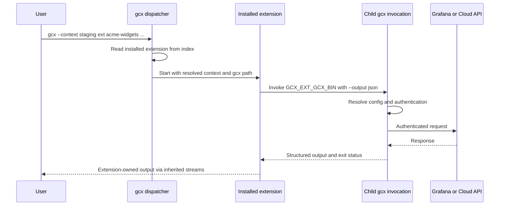

# RFC 003: Third-party extensions

## Summary

Add `gcx ext` to install, list, update, remove and run third-party programs. Authors distribute a program and a declarative manifest from a local directory, a static host or a git repository. gcx selects and verifies the appropriate artifact, records the installation and invokes it as a subprocess. Extensions that need Grafana or Cloud access call the invoking gcx binary, reusing its authentication and context resolution without a new credential-export API.

This is a proposal, not a shipped capability. It retains the extension design's narrow scope: independently maintained partner integrations and customer tooling, with no required registry, SDK or separate extension manager. The contract includes inherited configuration selection, checksummed remote script packages and extension-name reporting controlled by the existing usage-statistics setting. Remaining schema and platform details need validation before implementation can satisfy the full contract.

## Motivation

A partner wants to ship `gcx ext acme-widgets` to map its product's resources into Grafana. A customer wants an internal migration tool that reads legacy monitoring configuration and pushes dashboards through gcx. Neither tool should require a gcx release, review by gcx maintainers or hosting in this repository.

The existing [command tree](../../cmd/gcx/root/command.go) and provider registration model cover built-in capabilities. A third-party program needs a separate distribution and execution mechanism. The goals are easy authoring, support for the six native OS/architecture combinations gcx releases, freedom to choose a host, and management through gcx itself.

Being technically suitable for an extension does not decide where a capability belongs. A public API makes an extension feasible, but does not by itself justify shipping a stable Grafana capability outside core: ownership, discoverability and the shared CLI behavior contract still determine placement. Vendor-specific datasource onboarding, for example, might depend on an external toolchain and need no internal gcx API, yet still belong in core because users need to discover it during setup and a Grafana team owns its support. Moving stable Grafana product capabilities outside the command catalog would weaken the consistent experience described in [VISION.md](../../VISION.md).

## Scope

The first version covers manifest parsing, local and remote installation, one installed version per name, listing, explicit updates, removal and subprocess dispatch. Compiled programs and scripts are supported without a language-specific SDK. The native target matrix is Linux, macOS and Windows on amd64 and arm64; an individual install fails if its manifest does not support the current platform.

A central discovery index, `gcx ext search`, background updates, multiple installed versions, scaffolding, manifest generation, shell completion for extension names, sandboxing and artifact signatures are outside this version. Extensions do not register providers, resource adapters or individual commands in gcx's command tree. Full discovery through `gcx commands` and `gcx help-tree` is deferred.

The subprocess design targets native gcx. The embedded `wasip1` build cannot be assumed to support it; its command availability must be established before the feature is mounted.

## User experience

All `ext` commands and extension-specific fields below are proposed.

### Install and run an extension

An author supplies a repository containing `gcx-extension.yaml`:

```bash
gcx ext install https://git.example.com/acme/gcx-ext-acme-widgets.git
gcx ext list
gcx --context staging ext acme-widgets sync ./widgets.yaml --dry-run
```

Installation presents the extension's name, version, homepage, artifact location and checksum before asking for confirmation. The help and confirmation disclose the [shared responsibility model](#shared-responsibility-and-user-disclosures): the program is unaudited, runs with the user's permissions and is used at the user's own risk. Approval uses `--force` or enabled `GCX_AUTO_APPROVE`, following the existing [confirmation convention](../design/safety.md); a new `--yes` alias is not proposed. Installation does not execute extension code or author-supplied install hooks.

`gcx ext list` shows the installed name, version, source and description. `gcx ext --help` also lists installed extensions from the local index without running them.

The argument boundary is explicit: gcx global flags go before `ext`; every argument after the extension name belongs to the extension and is forwarded unchanged. In the example, gcx selects `staging`, while the extension interprets `sync`, the input path and `--dry-run`. gcx does not enforce dry-run behavior inside third-party code. Author guidance discourages reusing gcx global flag names because their meaning would depend on position.

### Update and remove

```bash
gcx ext update acme-widgets
gcx ext update --all
gcx ext uninstall acme-widgets
```

Updating reinstalls from the recorded source. A git source or a manifest URL at a floating location can publish a newer version there. A manifest URL pinned to a release stays pinned; gcx does not search for newer tags or releases. The fetched manifest must retain the installed extension name; a mismatch fails without changing either installation. Users change the source through an explicit install operation whose replacement plan shows the previous and proposed sources before approval. Removal deletes the installed extension and its index entry.

### Develop locally

An author writes a program and manifest by hand, then installs from a local path:

```bash
gcx ext install ./gcx-ext-acme-widgets
gcx ext acme-widgets --help
```

A platform row may point to a binary relative to the manifest using `path`, instead of a remote artifact location. A local build can use wildcard OS and architecture selectors because it is intended for the machine doing the install. A local script can use `script` instead of `platforms`; remotely distributed scripts use the checksummed packages described below. Interpreter and platform requirements remain the author's responsibility.

## Technical design

### Command placement and dispatch

`ext` is a tooling area alongside `config` and `dev`. CLI wiring belongs in `cmd/gcx/ext`; manifest, installation, index and execution logic belong in `internal/ext`, following the [layer boundaries](../../CONSTITUTION.md#architecture-invariants).

The built-in subcommands are `install`, `list`, `uninstall` and `update`. Other first arguments are looked up as installed extension names. Installation rejects the reserved names `install`, `list`, `uninstall`, `update` and `help`, plus `search` and `scaffold` for possible future management commands. Reserving a name does not commit to implementing that command. There is no separate `run` verb and no top-level `gcx <extension-name>` dispatch.

The `ext` area prevents collisions with top-level gcx commands, but management verbs and extension names still share the namespace immediately below it. The reserved set is fixed for the current major version: adding a management command must not make a previously valid extension invocation unreachable. For example, reserving `search` now permits a later `gcx ext search` without hiding an installed extension.

The fallback dispatcher is classified as `raw` under the [agent output protocol](../design/agent-mode.md). It forwards the extension's streams and exit status without wrapping its output or claiming that it obeys gcx's finite JSON contract. Management commands remain gcx-owned commands with their own declared output classes and normal structured errors. An extension need not match gcx's table formatting or color conventions.

Installed extensions appear in local extension help and listing, but not as individual entries in `gcx commands` or `gcx help-tree`. Agent mode is available to an extension through its environment; gcx cannot enforce its behavior. The [exit-code guide](../design/exit-codes.md) will need to document extension child statuses and distinguish them from gcx-owned failures before execution begins.

The constitution already uses “extension commands” to mean domain operations such as `acknowledge`. This proposal uses **third-party extension** for an external program. The dispatch grammar and terminology should be documented explicitly when the feature is accepted.

### Manifest

Each extension supplies `gcx-extension.yaml`, using the familiar `apiVersion`, `kind` and `metadata` shape. It is an installation document, not a Grafana resource for `gcx resources push`.

The following is an illustrative remote manifest. The artifact key is provisional: the original design prose called it `url`, while its example used `uri`; this RFC uses `uri` until the schema is settled. The checksum placeholder must be replaced with the artifact's full SHA-256 digest.

```yaml
apiVersion: gcx.grafana.com/v1
kind: Extension
metadata:
  name: acme-widgets
  description: Manage Acme widget resources from gcx
version: 1.4.0
minGCXVersion: 1.8.0
homepage: https://git.example.com/acme/gcx-ext-acme-widgets
platforms:
  - selector: {os: linux, arch: amd64}
    uri: https://downloads.example.com/acme-widgets/1.4.0/linux-amd64.tar.gz
    sha256: "<artifact-sha256>"
    bin: acme-widgets
```

The extension version is independent of the gcx version. `minGCXVersion` declares the minimum compatible gcx release; the illustrative version is not a promised release target. The installer checks compatibility before selecting an artifact. Authors add rows for the other platforms they support. If no row matches, installation fails; there is no build-from-source fallback.

For a local build, the corresponding entry can be:

```yaml
platforms:
  - selector: {os: "*", arch: "*"}
    path: ./bin/acme-widgets
```

A local script manifest can use `script: hello.sh` instead of the platform table. Remote scripts use the same `platforms` artifact entries as compiled programs: `uri` locates an archive, `sha256` verifies its bytes and `bin` identifies the executable script inside it. A manifest obtained from a URL or git repository cannot use `script` or `path` to bypass artifact verification. gcx runs the entry point directly rather than generating a shell command. The author supplies a suitable interpreter entry point; a Unix shebang alone does not establish Windows compatibility.

### Package a script

A package is an archive containing the script and any supporting files it needs. Its SHA-256 digest lets gcx verify that the downloaded archive matches the manifest before extracting it. There is no compilation step or SDK.

For example, save this as `hello.sh` on a Unix system:

```sh
#!/bin/sh
exec "$GCX_EXT_GCX_BIN" resources get dashboards --output json
```

Make it executable and create the archive:

```bash
chmod +x hello.sh
tar -czf hello_1.0.0.tar.gz hello.sh
```

Compute its digest with `shasum -a 256 hello_1.0.0.tar.gz` on macOS, or `sha256sum hello_1.0.0.tar.gz` on Linux. Upload that exact archive to an HTTPS location and copy the full digest into the manifest's platform entry:

```yaml
platforms:
  - selector: {os: linux, arch: amd64}
    uri: https://downloads.example.com/hello/1.0.0/hello_1.0.0.tar.gz
    sha256: "<full-sha256-from-the-command>"
    bin: hello.sh
```

Use the same archive and digest in other platform rows only where the script and its dependencies work. Recreating or changing the archive requires recomputing the digest. gcx checks it before extraction, preserves the executable entry point and never runs the script during installation. User-facing author documentation must include this minimal packaging recipe.

### Installation sources and local state

`gcx ext install <source>` accepts a local path, including a directory or archive, a direct manifest URL, or a git URL. Git sources use the user's installed `git` and its existing authentication; there is no GitHub API dependency or required hosting service. Remote manifests require HTTPS with certificate verification, and redirects must not downgrade to HTTP. Remote git sources use HTTPS or SSH with server identity verification; unauthenticated transports such as `git://` are unsupported. Downloads use gcx's shared HTTP infrastructure. A checksum from a manifest is useful only if the manifest itself arrived through a trusted transport.

Source, artifact and redirect URLs containing embedded credentials are rejected before use, persistence or display. This includes HTTP user information, access tokens and presigned authentication parameters; errors must not echo the rejected URL. SSH usernames identify the remote account and are allowed, but embedded passwords are not. The index and install/list output contain credential-free locations only. Private git sources use the user's existing git authentication; v1 adds no URL-based credential storage.

The extension directory follows the [configuration directory convention](../../internal/config/loader.go), normally `~/.config/gcx/extensions/`, with a proposed `GCX_EXTENSIONS_DIR` override. Payloads live under `<name>/<version>/`. A single `index.json` records each extension's name, version, description, source, executable path and installation time.

Only install, update and uninstall change the index. Listing and execution read it instead of scanning PATH, walking extension directories or invoking programs for metadata. Versioned directories identify the current payload; retaining several runnable versions is not part of this proposal.

The installation pipeline resolves the source, validates the manifest and gcx version, selects the executable, presents the installation plan, obtains approval, fetches or copies the payload, verifies it, extracts it if needed and records the installation. Missing or mismatched checksums fail closed for non-local artifacts. A failed verification must not create a runnable index entry. Atomic replacement, concurrent writers and archive containment need the concrete validation described below.

### Calling gcx from an extension

An extension reaches Grafana or Cloud by invoking the same gcx binary that launched it. This reuses the existing config, authentication and refresh behavior rather than introducing an extension credential API.

gcx launches the installed executable by its recorded path while preserving the caller's working directory. This keeps relative input paths such as `./widgets.yaml` meaningful and lets child gcx calls discover the same local `.gcx.yaml`. An extension that changes its own working directory must restore the invocation directory for callbacks that rely on local config discovery.

| Environment variable | Proposed value |
| --- | --- |
| `GCX_EXT_GCX_BIN` | Path to the invoking gcx executable |
| `GCX_EXT_NAME` | Installed name used for dispatch, which may differ from the executable name |
| `GCX_AGENT_MODE` | Agent mode resolved by the parent invocation |
| `GCX_CONTEXT` | Context name resolved by the parent invocation |
| `GCX_CONFIG` | Absolute path to an explicitly selected config file, when one was selected |

`GCX_CONTEXT` is a prerequisite, not an existing capability on main. Context selection follows explicit `--context`, then `GCX_CONTEXT`, then `current-context`. The parent passes its selected name to the extension; a child invocation can deliberately override it with `--context`. A missing selected context is an error, never a fallback to another target.

If the parent selected a file explicitly through `--config` or `GCX_CONFIG`, dispatch passes that selection through `GCX_CONFIG` as an absolute path. The parent's explicit flag takes precedence over its environment; an explicit child `--config` can override the inherited selection. Without an explicit file selection, dispatch leaves `GCX_CONFIG` unset and preserves normal system, user and local config layering. It must not turn the default user config path into an explicit selection that bypasses other layers.

Children inherit the parent's environment and invocation directory, then use ordinary gcx configuration loading and authentication refresh for each call. This preserves configuration selection, not a snapshot of the resolved destination or credentials. If the selected context's configuration is edited between calls, later calls see that edit; changing only `current-context` does not replace the inherited context name. Dispatch does not export resolved credentials or create a temporary config snapshot.

For example, a script can retrieve resources through the host:

```sh
"$GCX_EXT_GCX_BIN" resources get dashboards --output json
```

Authors must request `--output json` explicitly rather than relying on human or agent defaults. They must inspect stdout on nonzero exits too: a partial failure can emit a complete result document with per-item failures and exit 4. gcx-owned protocol behavior remains described in [DESIGN.md](../../DESIGN.md#dual-purpose-design).



This makes gcx's JSON outputs an integration surface. Existing envelopes vary by command; `minGCXVersion` only rejects versions that are too old and cannot detect incompatible later changes. The proposal accepts that limitation for the first version, without claiming that all existing outputs have a uniform schema or a new compatibility guarantee.

### Trust and credentials

An installed extension runs with the user's permissions and inherits the parent's environment. gcx does not audit the program, sandbox it, enforce permissions declared in a manifest or verify publisher signatures. A checksum establishes that an artifact matches its manifest, not that the author is trustworthy.

“No credential handoff” means gcx adds no dedicated token-export mechanism. It is not credential isolation: inherited variables can already contain credentials, and a process with the user's permissions may access local configuration and other user-accessible secrets. Calling gcx is the supported integration contract, not a technical restriction preventing the program from making its own network requests.

An author who needs a raw credential for a separate SDK receives no new API for that in this design. A future credential mechanism would need its own justification and review.

### Shared responsibility and user disclosures

Third-party extensions are independently supplied software. Installing, listing or running one through gcx does not mean that Grafana or the gcx maintainers have reviewed, approved, endorsed or agreed to support its contents. The contents and behavior of a third-party extension, and the consequences of choosing to run it, are outside the responsibility of gcx maintainers. This boundary applies to every supported distribution method, including the repository-only alternative below.

| Party | Responsibility |
| --- | --- |
| Extension author | Own the extension's code, dependencies, behavior, documentation and support, including any telemetry it collects |
| User or operating organisation | Decide whether to trust the author and code, review what is installed or updated, choose the permissions and credentials available to it, and accept the consequences of running it, including through an agent or automation |
| gcx maintainers | Maintain the documented installer and dispatcher behavior, including transport checks, artifact verification, safe installation, context propagation and disclosures; these mechanisms do not make third-party code safe or transfer responsibility for its contents to gcx |

An extension can act with the user's local permissions and available API access. Users must understand that it can read or change files, access available secrets, make network requests and modify remote resources. Checksums establish artifact integrity; they do not establish safety or publisher trust. The responsibility boundary does not excuse defects in gcx's own installer or dispatcher.

Before the feature ships, publish a user-facing extension guide covering this model, the trust and credential boundaries, author support ownership, and the limits of gcx's checks. Link it from the normal user documentation navigation and `gcx ext --help`; an RFC alone is not sufficient disclosure. Both the guide and command help must state that users run third-party extensions at their own risk and that gcx maintainers are not responsible for their contents or the consequences of running them.

The CLI must surface the model at the points where users acquire or execute code:

- `gcx ext --help` and install/update help include the responsibility statement and a link to the user guide.
- Install and update plans identify the extension name, version and source and display the statement before approval. Updates repeat it because they introduce new code, even when the publisher is unchanged.
- Each `gcx ext <name>` invocation emits a brief notice identifying the third-party extension and the user's responsibility before starting the process. This is a diagnostic on stderr; stdout remains extension-owned output. It does not introduce an additional execution confirmation prompt.
- Notices remain visible in agent and non-interactive use. `--force` and `GCX_AUTO_APPROVE` bypass confirmation only; they do not suppress disclosure.

The install/update statement should use direct language, for example:

> This is a third-party extension. Grafana and the gcx maintainers do not review, endorse or support its contents and are not responsible for the consequences of running it. It runs with your permissions and available credentials. You are responsible for reviewing it and use it at your own risk.

The execution notice may be shorter while preserving the boundary, for example: `running third-party extension <name> (<version>) at your own risk; gcx does not review or support its contents`. gcx-owned notices use the shared diagnostic output facilities and must never be mixed into extension stdout or the structured results of management commands.

### Usage telemetry

gcx records `gcx ext <name>` through the existing [telemetry pipeline](../../internal/telemetry/event.go). A name is eligible only after it matches an installed index entry; unmatched text is discarded. Arguments and extension flag values are never recorded. Names are plain text so usage can be attributed to individual extensions.

Extension usage follows the existing [usage-statistics setting and precedence](../../internal/telemetry/telemetry.go), which is enabled by default. The existing opt-out, including `GCX_TELEMETRY=disabled` or `diagnostics.telemetry: disabled` in config, disables extension events as well as built-in command events. There is no separate extension-name opt-in or manifest-level opt-out. Disabled means no extension event is emitted, including a generic `gcx ext` event; the existing local-only `log` mode continues to send nothing.

Extension names can identify an organisation or internal workflow. Reporting them is an explicit exception to the existing privacy rule, controlled by the user's usage-statistics setting. Before release, update the telemetry policy, published usage-statistics documentation and first-run notice, including its revision for existing installations, to disclose name reporting. Authors may implement their own extension telemetry, but gcx cannot enforce its opt-out on arbitrary third-party code; user documentation must keep that boundary clear.

## Drawbacks

Authors maintain manifests, platform artifacts and checksums themselves. Script runtimes are additional user dependencies, and installation cannot promise cross-platform execution merely because a script needs no compilation. Users discover extensions through their authors rather than a central index.

Agents cannot discover individual extension capabilities through gcx's normal catalog, and gcx cannot guarantee their output, errors, safety or support ownership. These costs make extensions a poor default for stable Grafana-owned capabilities. The mechanism cannot enforce that organisational boundary.

Parsing gcx JSON couples extensions to command outputs. Author testing and `minGCXVersion` provide limited protection; neither detects every future incompatibility. Extension processes also retain the user's broad local permissions, and the proposed telemetry names can disclose organisational information.

## Rationale and alternatives

The prior design compared the gh, kubectl/krew, Cargo, Docker and Helm extension models. The useful lessons are a declarative platform manifest, an explicit installation record and calling the host CLI for its existing API workflows. This proposal combines those ideas without adopting a separate package manager or requiring a publisher-controlled install script. A Docker-style metadata handshake could improve discovery, but adds a public protocol and runtime validation beyond installation and dispatch.

Flat `gcx <name>` dispatch would introduce collisions with future built-in areas and conflict with the [closed top-level grammar](../../CONSTITUTION.md#cli-grammar). Keeping extensions under `ext` makes ownership visible. A separate `gcx ext run <name>` would avoid fallback dispatch but adds another verb; the proposed contract instead reserves management names and forwards the remaining arguments unchanged.

In-process plugins would couple extension authors to gcx's build and runtime. Separate programs preserve language independence and fit the native release matrix. A build-from-source fallback would introduce toolchain detection and a second installation path, so an unsupported platform fails explicitly.

A credential-resolution command, permission manifest and language SDK would add another authentication interface when calling gcx already serves the motivating cases. Scaffolding and generated manifests may reduce author effort later, but neither is necessary to establish the execution contract.

### Alternative: require a git repository

Every extension could instead be a git repository containing a small manifest, hosted on any supported git server. Installation would accept a repository URL or local checkout; standalone manifest URLs and local archives would no longer be installation sources. This is an alternative for review, not a change to the distribution contract above.

The installed record would retain the repository URL, selected ref and installed commit. Installation would obtain the repository snapshot and read its manifest. Updates would follow the selected ref, while an explicit commit pin would remain fixed. Remote retrieval would use the user's existing git authentication over the trusted transports described above, without GitHub-specific APIs or release discovery.

Scripts and their supporting files would live in the repository and run from the installed snapshot. Authors would commit those files rather than publish a separate script archive and checksum. Git would supply the snapshot and commit identity, with trusted transport protecting retrieval; this would not establish publisher trust or imply signature verification. Compiled programs would continue to use platform-specific artifacts declared in the manifest, with mandatory checksums for those external downloads. Neither automatic builds nor installation hooks would be introduced.

This would reduce source-resolution paths and give scripts and binaries one source/update model. Requiring a repository alone would save less: retaining the remote-script packaging requirement would still make authors publish a second artifact. Adopting this alternative would therefore replace that requirement for repository-contained scripts, while retaining it for external artifacts.

The tradeoff is a git requirement for remote installation and the loss of installation from a static manifest host alone. Authors would need a repository even for a single executable, and binary artifact downloading would still exist. Safe installation, atomic updates, platform selection, extension identity checks and the execution/configuration contracts would remain necessary.

## Validation

This conversion carries forward design conclusions from the earlier extension proposal; it does not independently verify the prototype or claim production readiness. Validation must exercise the following contracts before release:

| Contract | Required evidence |
| --- | --- |
| Independently owned use case | A real partner or customer authors and maintains an extension outside gcx, exercising authoring, installation, updates and authenticated calls. The Azure onboarding prototype tests the mechanism but does not establish this independently owned workflow |
| Manifest and platform selection | Table-driven tests for required fields, reserved names, minimum gcx version, each native platform, local wildcard rows and no matching artifact |
| Hosting independence | Install from a local directory/archive, a static manifest host and a non-GitHub git repository without host-specific APIs |
| Source trust | Reject HTTP manifests, HTTPS-to-HTTP redirects and unauthenticated remote git transports; reject credential-bearing source, artifact and redirect URLs without persisting or echoing secrets |
| Artifact integrity | Package and install the documented script example; verify its checksum and executable entry point; missing or incorrect remote checksums and remote `script`/`path` shortcuts fail without a runnable registration; archive entries cannot escape the installation directory |
| Installation state | Failed updates and manifest-name mismatches preserve existing installations; explicit source replacement presents both sources for approval; simultaneous mutations do not corrupt or lose index entries |
| Approval | Interactive decline returns cancellation; agent mode requires the documented bypass; no extension code runs during install |
| Responsibility disclosures | The user guide and help contain the responsibility model; install/update plans and each execution show the required notice, including agent and auto-approved paths; diagnostics stay on stderr without changing structured or extension stdout |
| Argument and process behavior | Global flags before `ext`, verbatim child arguments, preserved working directory and relative inputs, reserved-name handling, inherited streams, nonzero child exits and interruption; new management commands cannot hide previously valid extension names |
| Context and authentication | Verify flag/environment/current-context precedence, absolute explicit-file propagation, preserved layering and local config discovery, missing-context failure, auth refresh and resolved agent mode; changing the selected context between child calls is observed, while changing only `current-context` does not redirect them |
| Output consumption | An example extension explicitly requests JSON and handles a structured partial failure on stdout despite exit 4 |
| Telemetry | Enabled usage statistics include installed names only; the existing opt-out suppresses all extension events, local-only log mode sends nothing, and unmatched names and extension arguments cannot reach any telemetry field; the updated notice reaches existing installations |
| Portability | Compiled execution across all six native targets, documented script/interpreter behavior, and a defined `wasip1` command surface |

Implementation can proceed in small slices: manifest validation, directory/index management, local installation, remote sources, update/removal and CLI dispatch. Context propagation must be ready before end-to-end dispatch is considered correct. Command wiring must include output metadata, help, user and author documentation, and tests for the final process boundary. Architecture and package-map documentation should change with the implementation they describe.

## Unresolved questions

- **Manifest and install state:** finalize `uri` versus `url`, version-constraint syntax, valid names, source classification and script/platform exclusivity. Establish atomic update and index-write behavior through failure and concurrency tests.
- **Process portability:** establish Windows interpreter behavior, interruption and exit-status propagation, and native-only command registration for `wasip1` if subprocess execution is unavailable there.

These are acceptance gaps in the proposed contract. They remain open rather than being resolved by the format conversion.

## Future possibilities

If adoption justifies them, follow-up proposals could add a discovery index, an author scaffold, generated manifests from release output, a small helper for calling gcx and parsing results, or a metadata handshake for agent discovery. A credential interface would require a concrete use case that the host commands cannot serve. None is a dependency of the initial extension mechanism.

## Terminology

- **Third-party extension:** an independently distributed executable or script installed and invoked through `gcx ext`.
- **Manifest:** the author's installation document describing identity, compatibility and executable selection.
- **Installation index:** gcx's local record of installed extensions and their sources; not a public discovery catalog.
- **Install source:** the local path, manifest URL or git URL recorded for later updates.
- **Raw dispatch:** passing through extension-owned output and process status without claiming gcx's finite-output contract.
