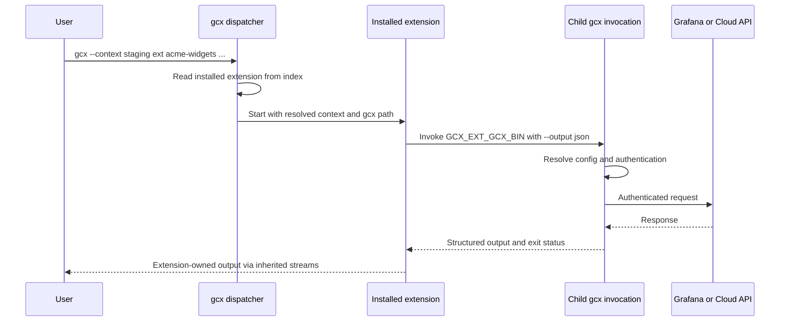

# RFC 003: Third-party extensions

## Summary

Add `gcx ext` to install, list, update, remove and run third-party programs. Authors distribute a program and a declarative manifest from a local directory, a static host or a git repository. gcx selects and verifies the appropriate artifact, records the installation and invokes it as a subprocess. Extensions that need Grafana or Cloud access call the invoking gcx binary, reusing its authentication and context resolution without a new credential-export API.

This is a proposal, not a shipped capability. It retains the extension design's narrow scope: independently maintained partner integrations and customer tooling, with no required registry, SDK or separate extension manager. Context propagation, remote script verification and the proposed telemetry privacy exception still need resolution before implementation can satisfy the full contract.

## Motivation

A partner wants to ship `gcx ext acme-widgets` to map its product's resources into Grafana. A customer wants an internal migration tool that reads legacy monitoring configuration and pushes dashboards through gcx. Neither tool should require a gcx release, review by gcx maintainers or hosting in this repository.

The existing [command tree](../../cmd/gcx/root/command.go) and provider registration model cover built-in capabilities. A third-party program needs a separate distribution and execution mechanism. The goals are easy authoring, support for the six native OS/architecture combinations gcx releases, freedom to choose a host, and management through gcx itself.

Being technically suitable for an extension does not decide where a capability belongs. Vendor-specific datasource onboarding, for example, might depend on an external toolchain and need no internal gcx API, yet still belong in core because users need to discover it during setup and a Grafana team owns its support. Moving stable Grafana product capabilities outside the command catalog would weaken the consistent experience described in [VISION.md](../../VISION.md).

## Scope

The first version covers manifest parsing, local and remote installation, one installed version per name, listing, explicit updates, removal and subprocess dispatch. Compiled programs and scripts are supported without a language-specific SDK. The native target matrix is Linux, macOS and Windows on amd64 and arm64; an individual install fails if its manifest does not support the current platform.

A central discovery index, `gcx ext search`, background updates, multiple installed versions, scaffolding, manifest generation, shell completion for extension names, sandboxing and artifact signatures are outside this version. Extensions do not register providers, resource adapters or individual commands in gcx's command tree. Full discovery through `gcx commands` and `gcx help-tree` is deferred.

The subprocess design targets native gcx. The embedded `wasip1` build cannot be assumed to support it; its command availability must be established before the feature is mounted.

## User experience

All `ext` commands and extension-specific fields below are proposed.

### Install and run an extension

An author supplies a repository containing `gcx-extension.yaml`:

```bash
gcx ext install https://git.example.com/acme/gcx-ext-acme-widgets.git
gcx ext list
gcx --context staging ext acme-widgets sync ./widgets.yaml --dry-run
```

Installation presents the extension's name, version, homepage, artifact location and checksum before asking for confirmation. The help and confirmation explain that the program is unaudited and will run with the user's permissions. Approval uses `--force` or enabled `GCX_AUTO_APPROVE`, following the existing [confirmation convention](../design/safety.md); a new `--yes` alias is not proposed. Installation does not execute extension code or author-supplied install hooks.

`gcx ext list` shows the installed name, version, source and description. `gcx ext --help` also lists installed extensions from the local index without running them.

The argument boundary is explicit: gcx global flags go before `ext`; every argument after the extension name belongs to the extension and is forwarded unchanged. In the example, gcx selects `staging`, while the extension interprets `sync`, the input path and `--dry-run`. gcx does not enforce dry-run behavior inside third-party code. Author guidance discourages reusing gcx global flag names because their meaning would depend on position.

### Update and remove

```bash
gcx ext update acme-widgets
gcx ext update --all
gcx ext uninstall acme-widgets
```

Updating reinstalls from the recorded source. A git source or a manifest URL at a floating location can publish a newer version there. A manifest URL pinned to a release stays pinned; gcx does not search for newer tags or releases. Users reinstall from a different source to change that choice. Removal deletes the installed extension and its index entry.

### Develop locally

An author writes a program and manifest by hand, then installs from a local path:

```bash
gcx ext install ./gcx-ext-acme-widgets
gcx ext acme-widgets --help
```

A platform row may point to a binary relative to the manifest using `path`, instead of a remote artifact location. A local build can use wildcard OS and architecture selectors because it is intended for the machine doing the install. A script can use `script` instead of `platforms`; its interpreter and platform requirements remain the author's responsibility.

## Technical design

### Command placement and dispatch

`ext` is a tooling area alongside `config` and `dev`. CLI wiring belongs in `cmd/gcx/ext`; manifest, installation, index and execution logic belong in `internal/ext`, following the [layer boundaries](../../CONSTITUTION.md#architecture-invariants).

The built-in subcommands are `install`, `list`, `uninstall` and `update`. Other first arguments are looked up as installed extension names. These management names are reserved and rejected at installation; names that collide with built-in help behavior must also be covered by validation. There is no separate `run` verb and no top-level `gcx <extension-name>` dispatch.

The fallback dispatcher is classified as `raw` under the [agent output protocol](../design/agent-mode.md). It forwards the extension's streams and exit status without wrapping its output or claiming that it obeys gcx's finite JSON contract. Management commands remain gcx-owned commands with their own declared output classes and normal structured errors. An extension need not match gcx's table formatting or color conventions.

Installed extensions appear in local extension help and listing, but not as individual entries in `gcx commands` or `gcx help-tree`. Agent mode is available to an extension through its environment; gcx cannot enforce its behavior. The [exit-code guide](../design/exit-codes.md) will need to document extension child statuses and distinguish them from gcx-owned failures before execution begins.

The constitution already uses “extension commands” to mean domain operations such as `acknowledge`. This proposal uses **third-party extension** for an external program. The dispatch grammar and terminology should be documented explicitly when the feature is accepted.

### Manifest

Each extension supplies `gcx-extension.yaml`, using the familiar `apiVersion`, `kind` and `metadata` shape. It is an installation document, not a Grafana resource for `gcx resources push`.

The following is an illustrative remote manifest. The artifact key is provisional: the original design prose called it `url`, while its example used `uri`; this RFC uses `uri` until the schema is settled. The checksum placeholder must be replaced with the artifact's full SHA-256 digest.

```yaml
apiVersion: gcx.grafana.com/v1
kind: Extension
metadata:
  name: acme-widgets
  description: Manage Acme widget resources from gcx
version: 1.4.0
minGCXVersion: 1.8.0
homepage: https://git.example.com/acme/gcx-ext-acme-widgets
platforms:
  - selector: {os: linux, arch: amd64}
    uri: https://downloads.example.com/acme-widgets/1.4.0/linux-amd64.tar.gz
    sha256: "<artifact-sha256>"
    bin: acme-widgets
telemetry:
  reportUsage: false
```

The extension version is independent of the gcx version. `minGCXVersion` declares the minimum compatible gcx release; the illustrative version is not a promised release target. The installer checks compatibility before selecting an artifact. Authors add rows for the other platforms they support. If no row matches, installation fails; there is no build-from-source fallback.

For a local build, the corresponding entry can be:

```yaml
platforms:
  - selector: {os: "*", arch: "*"}
    path: ./bin/acme-widgets
```

A script manifest uses `script: hello.sh` instead of the platform table. gcx runs the program directly rather than generating a shell command. The author supplies a suitable interpreter entry point; a Unix shebang alone does not establish Windows compatibility. Remote script packaging and integrity verification remain unresolved below.

### Installation sources and local state

`gcx ext install <source>` accepts a local path, including a directory or archive, a direct manifest URL, or a git URL. Git sources use the user's installed `git` and its existing authentication; there is no GitHub API dependency or required hosting service. HTTP downloads use gcx's shared HTTP infrastructure.

The extension directory follows the [configuration directory convention](../../internal/config/loader.go), normally `~/.config/gcx/extensions/`, with a proposed `GCX_EXTENSIONS_DIR` override. Payloads live under `<name>/<version>/`. A single `index.json` records each extension's name, version, description, source, executable path and installation time, plus the information needed to honor its telemetry setting.

Only install, update and uninstall change the index. Listing and execution read it instead of scanning PATH, walking extension directories or invoking programs for metadata. Versioned directories identify the current payload; retaining several runnable versions is not part of this proposal.

The installation pipeline resolves the source, validates the manifest and gcx version, selects the executable, presents the installation plan, obtains approval, fetches or copies the payload, verifies it, extracts it if needed and records the installation. Missing or mismatched checksums fail closed for non-local artifacts. A failed verification must not create a runnable index entry. Atomic replacement, concurrent writers and archive containment need the concrete validation described below.

### Calling gcx from an extension

An extension reaches Grafana or Cloud by invoking the same gcx binary that launched it. This reuses the existing config, authentication and refresh behavior rather than introducing an extension credential API.

| Environment variable | Proposed value |
| --- | --- |
| `GCX_EXT_GCX_BIN` | Path to the invoking gcx executable |
| `GCX_EXT_NAME` | Installed name used for dispatch, which may differ from the executable name |
| `GCX_AGENT_MODE` | Agent mode resolved by the parent invocation |
| `GCX_CONTEXT` | Context resolved by the parent invocation |

`GCX_CONTEXT` is a prerequisite, not an existing capability on main. It must participate in normal context selection, with an explicit child `--context` taking precedence. Otherwise `gcx --context staging ext acme-widgets` can call back into gcx and silently operate on `current-context` instead. The full propagation contract must also cover an explicit parent `--config`: preserving only the context name is insufficient when the child loads a different config file.

For example, a script can retrieve resources through the host:

```sh
"$GCX_EXT_GCX_BIN" resources get dashboards --output json
```

Authors must request `--output json` explicitly rather than relying on human or agent defaults. They must inspect stdout on nonzero exits too: a partial failure can emit a complete result document with per-item failures and exit 4. gcx-owned protocol behavior remains described in [DESIGN.md](../../DESIGN.md#dual-purpose-design).



This makes gcx's JSON outputs an integration surface. Existing envelopes vary by command; `minGCXVersion` only rejects versions that are too old and cannot detect incompatible later changes. The proposal accepts that limitation for the first version, without claiming that all existing outputs have a uniform schema or a new compatibility guarantee.

### Trust and credentials

An installed extension runs with the user's permissions and inherits the parent's environment. gcx does not audit the program, sandbox it, enforce permissions declared in a manifest or verify publisher signatures. A checksum establishes that an artifact matches its manifest, not that the author is trustworthy.

“No credential handoff” means gcx adds no dedicated token-export mechanism. It is not credential isolation: inherited variables can already contain credentials, and a process with the user's permissions may access local configuration and other user-accessible secrets. Calling gcx is the supported integration contract, not a technical restriction preventing the program from making its own network requests.

An author who needs a raw credential for a separate SDK receives no new API for that in this design. A future credential mechanism would need its own justification and review.

### Proposed usage telemetry

The original proposal records `gcx ext <name>` through the existing [telemetry pipeline](../../internal/telemetry/event.go), preserving the user's global opt-out. A name is eligible only after it matches an installed index entry; unmatched text is discarded. Arguments and extension flag values are never recorded.

Names would be recorded in plain text to measure extension popularity. `telemetry.reportUsage: false` suppresses the extension name; the proposed default is `true`. This is a requested policy exception: an installed name can still identify an organisation, so an index lookup does not make it compatible with the current privacy invariant. Author opt-out also does not protect an internal extension whose author leaves the default unchanged.

The RFC retains this proposal for review but does not treat the exception as approved. Acceptance requires an explicit privacy decision, corresponding policy and first-run notice updates, and verification that opted-out names cannot reach telemetry fields. Whether an opted-out invocation still emits a generic `gcx ext` event must be settled at the same time.

## Drawbacks

Authors maintain manifests, platform artifacts and checksums themselves. Script runtimes are additional user dependencies, and installation cannot promise cross-platform execution merely because a script needs no compilation. Users discover extensions through their authors rather than a central index.

Agents cannot discover individual extension capabilities through gcx's normal catalog, and gcx cannot guarantee their output, errors, safety or support ownership. These costs make extensions a poor default for stable Grafana-owned capabilities. The mechanism cannot enforce that organisational boundary.

Parsing gcx JSON couples extensions to command outputs. Author testing and `minGCXVersion` provide limited protection; neither detects every future incompatibility. Extension processes also retain the user's broad local permissions, and the proposed telemetry names can disclose organisational information.

## Rationale and alternatives

The prior design compared the gh, kubectl/krew, Cargo, Docker and Helm extension models. The useful lessons are a declarative platform manifest, an explicit installation record and calling the host CLI for its existing API workflows. This proposal combines those ideas without adopting a separate package manager or requiring a publisher-controlled install script. A Docker-style metadata handshake could improve discovery, but adds a public protocol and runtime validation beyond installation and dispatch.

Flat `gcx <name>` dispatch would introduce collisions with future built-in areas and conflict with the [closed top-level grammar](../../CONSTITUTION.md#cli-grammar). Keeping extensions under `ext` makes ownership visible. A separate `gcx ext run <name>` would avoid fallback dispatch but adds another verb; the proposed contract instead reserves management names and forwards the remaining arguments unchanged.

In-process plugins would couple extension authors to gcx's build and runtime. Separate programs preserve language independence and fit the native release matrix. A build-from-source fallback would introduce toolchain detection and a second installation path, so an unsupported platform fails explicitly.

A credential-resolution command, permission manifest and language SDK would add another authentication interface when calling gcx already serves the motivating cases. Scaffolding and generated manifests may reduce author effort later, but neither is necessary to establish the execution contract.

## Validation

This conversion carries forward design conclusions from the earlier extension proposal; it does not independently verify the prototype or claim production readiness. Validation must exercise the following contracts before release:

| Contract | Required evidence |
| --- | --- |
| Manifest and platform selection | Table-driven tests for required fields, reserved names, minimum gcx version, each native platform, local wildcard rows and no matching artifact |
| Hosting independence | Install from a local directory/archive, a static manifest host and a non-GitHub git repository without host-specific APIs |
| Artifact integrity | Missing and incorrect remote checksums fail without a runnable registration; archive entries cannot escape the installation directory |
| Installation state | Failed updates preserve the runnable installation; simultaneous mutations do not corrupt or lose index entries |
| Approval | Interactive decline returns cancellation; agent mode requires the documented bypass; no extension code runs during install |
| Argument and process behavior | Global flags before `ext`, verbatim child arguments, reserved-name handling, inherited streams, nonzero child exits and interruption |
| Context and authentication | Use contexts pointing to different test destinations and a separate explicit config file; child calls retain the selected target, auth refresh and resolved agent mode |
| Output consumption | An example extension explicitly requests JSON and handles a structured partial failure on stdout despite exit 4 |
| Telemetry | Global opt-out, author opt-out and unmatched names cannot leak names or arguments through command, flag, error or other fields |
| Portability | Compiled execution across all six native targets, documented script/interpreter behavior, and a defined `wasip1` command surface |

Implementation can proceed in small slices: manifest validation, directory/index management, local installation, remote sources, update/removal and CLI dispatch. Context propagation must be ready before end-to-end dispatch is considered correct. Command wiring must include output metadata, help, user and author documentation, and tests for the final process boundary. Architecture and package-map documentation should change with the implementation they describe.

## Unresolved questions

- **Telemetry policy:** approve the explicit name-reporting exception and default, or revise reporting to fit the existing privacy invariant. Decide generic-event behavior for author opt-out and update the user notice if the exception is accepted.
- **Context propagation:** define `GCX_CONTEXT` precedence and forwarding of explicit config selection and other relevant invocation overrides. Prove parent and child target the same stack, including when config files contain different contexts with the same name.
- **Remote scripts and local paths:** define how a remote script payload is packaged and checksummed, including git sources and direct manifest URLs. A remote manifest must not bypass verification by selecting `script` or `path`.
- **Manifest and install state:** finalize `uri` versus `url`, version-constraint syntax, valid names, source classification and script/platform exclusivity. Establish atomic update and index-write behavior through failure and concurrency tests.
- **Process portability:** establish Windows interpreter behavior, interruption and exit-status propagation, and native-only command registration for `wasip1` if subprocess execution is unavailable there.

These are acceptance gaps in the proposed contract. They remain open rather than being resolved by the format conversion.

## Future possibilities

If adoption justifies them, follow-up proposals could add a discovery index, an author scaffold, generated manifests from release output, a small helper for calling gcx and parsing results, or a metadata handshake for agent discovery. A credential interface would require a concrete use case that the host commands cannot serve. None is a dependency of the initial extension mechanism.

## Terminology

- **Third-party extension:** an independently distributed executable or script installed and invoked through `gcx ext`.
- **Manifest:** the author's installation document describing identity, compatibility and executable selection.
- **Installation index:** gcx's local record of installed extensions and their sources; not a public discovery catalog.
- **Install source:** the local path, manifest URL or git URL recorded for later updates.
- **Raw dispatch:** passing through extension-owned output and process status without claiming gcx's finite-output contract.
